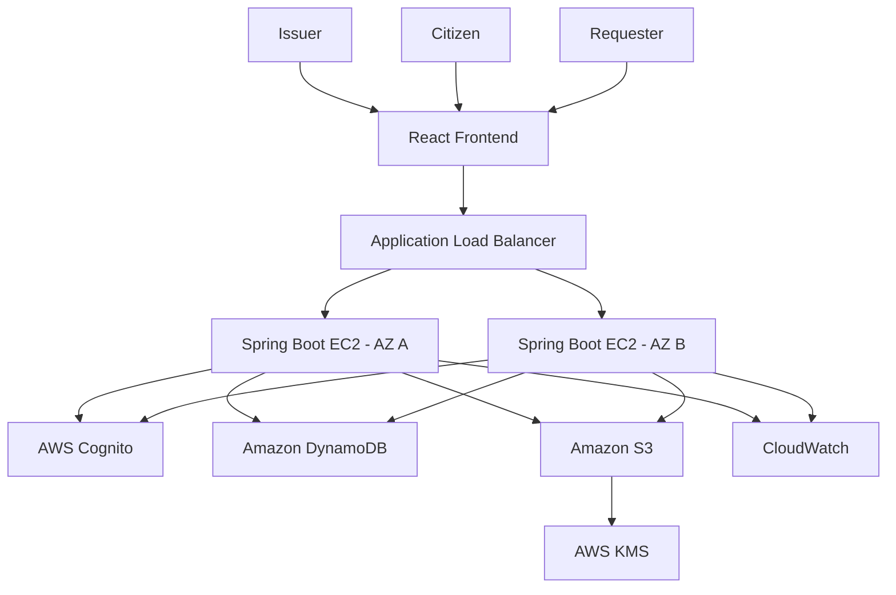

# DigiLocker Cloud – System Architecture

## 1. Introduction

The project is an educational prototype inspired by
digital document storage and verification systems.

It allows issuers to publish academic records,
citizens to manage documents and control sharing,
and requesters to request and verify documents.

## 2. Technology Stack

### Frontend
- React
- Tailwind CSS

### Backend
- Java
- Spring Boot
- REST APIs

### Authentication
- AWS Cognito
- Spring Security

### Database
- Amazon DynamoDB

### Document Storage
- Amazon S3
- AWS KMS

### Cloud Infrastructure
- Amazon EC2
- Application Load Balancer
- Auto Scaling Group
- CloudWatch

### Version Control
- Git
- GitHub

## 3. High-Level Application Architecture

## 4. Application Components

### 4.1 Issuer

- Registers student information.
- Uploads academic documents.
- Generates SHA-256 document hashes.
- Stores document metadata.

### 4.2 Citizen

- Links academic documents.
- Views linked documents.
- Approves or rejects document requests.
- Controls document sharing permissions.

### 4.3 Requester

- Creates document requests.
- Specifies the purpose of access.
- Tracks request status.
- Retrieves documents after valid approval.
- Verifies document integrity using SHA-256.

## 5. AWS Service Responsibilities

| AWS Service | Responsibility |
|---|---|
| Cognito | Authentication |
| Spring Boot | Backend APIs and business logic |
| DynamoDB | User profiles, document metadata and consent |
| S3 | Private document storage |
| KMS | Document encryption |
| EC2 | Backend application hosting |
| ALB | Traffic distribution |
| Auto Scaling | Instance scaling and replacement |
| CloudWatch | Monitoring and logs |

## 6. High Availability Architecture

The working cloud component is designed to run
in one AWS Region across two Availability Zones.

- Availability Zone A hosts a Spring Boot EC2 instance.
- Availability Zone B hosts another Spring Boot EC2 instance.
- An Application Load Balancer distributes incoming requests.
- Health checks identify unhealthy application instances.
- Auto Scaling can replace failed instances.
- CloudWatch monitors application and infrastructure health.

## 7. National-Scale Architecture Design

The conceptual national-scale design considers
two geographic AWS Regions:

- Mumbai: ap-south-1
- Hyderabad: ap-south-2

The architecture design includes geographic
traffic routing, health monitoring, metadata
replication and disaster recovery planning.

Multi-region deployment is a design target unless
it is actually deployed and tested.

## 8. Document Security

- Private S3 bucket.
- Server-side encryption.
- Role-based authorization.
- Restricted document access.
- Consent expiry and revocation checks.
- Audit logging.
- SHA-256 integrity verification.

## 9. Failover Demonstration

The planned demonstration includes:

1. Show both EC2 instances as healthy targets.
2. Send repeated requests through the ALB.
3. Stop one application instance.
4. Observe target health and continued responses.
5. Verify recovery and replacement behaviour.
6. Preserve screenshots and video evidence.

The actual observed results will be documented
after deployment and testing.

## 10. Conclusion

The architecture combines a document management
application with AWS cloud infrastructure.

The prototype demonstrates document workflows,
security controls, high availability and
infrastructure failover.
